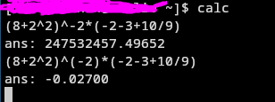

This is my calculator project which uses shunting yard algortihm to parse and solve math problems.

The idea for calculator came when I needed a calculator for my bash terminal. Now I have an alias setup so that I can calculate anything by typing "calc" on my bash and then typing a mathematical problem.

You can use the operators +, -, *, /, ( ) and ^ (power).

## Demo pictures

